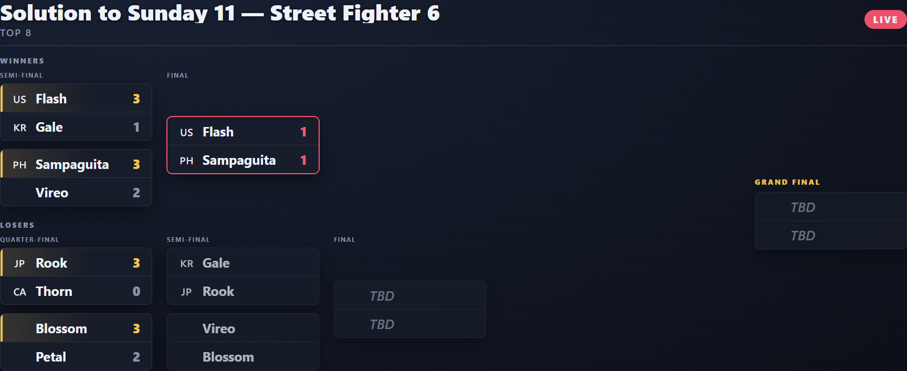
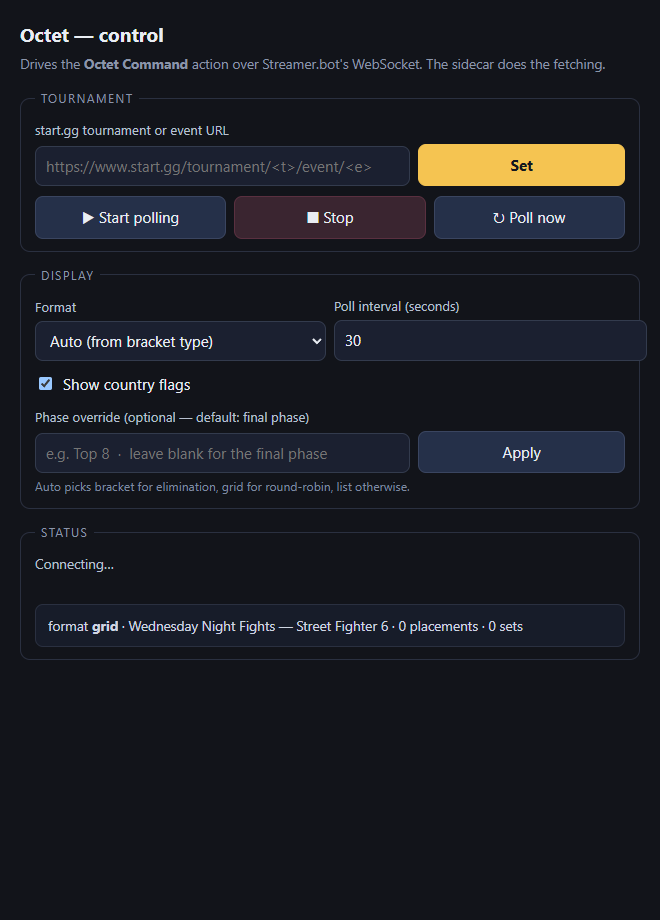

# Octet — a live Top-8 / top-cut tournament scene for OBS, driven by Streamer.bot

Octet is a single OBS browser source that shows a tournament's **final bracket
(top cut)** and updates live as sets finish. It reads **start.gg** now (other
services are drop-in). Two things make it flexible:

- **Format-agnostic** — the same data renders as a **bracket tree**, a **grid**
  (round-robin pools), or a **standings list**. Octet auto-picks from the
  bracket type, or you force one.
- **Theme-agnostic** — reskin it entirely in CSS to match your StreamKit; the JS
  only sets text and classes. See [docs/THEMING.md](docs/THEMING.md).



<sub>Grid (round-robin) and list formats: [docs/octet-grid.png](docs/octet-grid.png) · [docs/octet-list.png](docs/octet-list.png)</sub>

## Pieces

| Piece | What it is |
|---|---|
| `overlay/octet.html` + `formats/` | the scene (OBS Browser Source), one renderer per format |
| `octet-shared/panel-core.js` | the SB WebSocket transport (raw WS, no CDN — works offline in OBS CEF) |
| `octet-shared/control.html` | operator page: set URL, start/stop, format, flags |
| `octet-sidecar.mjs` | the Node poller — fetches start.gg, pushes `octet:update` |
| `platforms/` | data providers (`startgg` + stubs); [add one](docs/THEMING.md#3-add-a-provider) |
| `actions/*.cs` | the three Streamer.bot C# actions |

Only runtime dependency anywhere is `ws`. Nothing from npm ships to the browser.

## Quick start (offline, no Streamer.bot)

```bash
npm install
npm start                     # mock Streamer.bot on :7474 (HTTP) + :8080 (WS)
```
Open <http://127.0.0.1:7474/> and click a scene link, then **/mock/fixture** to
paint the sample Top 8. This is the theme/dev loop — no SB, no OBS needed.

## Streamer.bot setup (live)

1. **WebSocket Server** — SB → Servers/Clients → *WebSocket Server* → enable on
   `127.0.0.1:8080`, **authentication OFF** (required).
2. **HTTP Server** — enable on `127.0.0.1:7474` and add two **Path → Folder** maps:
   - `octet-overlay` → `<this repo>\overlay`
   - `octet-shared`  → `<this repo>\octet-shared`
3. **C# actions** — create three actions with these **exact** names, each a single
   *Core → C# → Execute C# Code* sub-action holding the matching file (Compile must
   be green):
   - **Octet Push** ← [`actions/octet-push.cs`](actions/octet-push.cs)
   - **Octet Command** ← [`actions/octet-command.cs`](actions/octet-command.cs)
   - **Octet Sidecar Start** *(optional)* ← [`actions/octet-sidecar-start.cs`](actions/octet-sidecar-start.cs)
     (edit `BUNDLE`; add a `System.dll` reference — see the file header)
4. **Configure + run the sidecar** — copy `config.example.json` → `config.json`,
   set `tournamentUrl` (and an optional `startggApiKey`), then double-click
   `start-octet.bat` (or `npm run sidecar`, or trigger *Octet Sidecar Start*).
5. **Add the OBS source** — a **Browser Source** (1920×1080) pointing at
   `http://127.0.0.1:7474/octet-overlay/octet.html?sbport=8080`. Add `&format=grid`
   (or `list`) to force a format.

Open the control page at
`http://127.0.0.1:7474/octet-shared/control.html?sbport=8080` to set the URL,
start/stop polling, switch format, and toggle flags on the fly.



## Formats

| Format | Shows | Auto-picked when |
|---|---|---|
| `bracket` | winners/losers/grand-final tree | phase is single/double elimination |
| `grid` | one table per round-robin pool (rank · W-L) | phase is round-robin / swiss |
| `list` | ranked standings 1–8 (ties preserved) | anything else, or before the bracket starts |

`format:"auto"` (default) reads the final phase's bracket type. Override per-source
with `?format=`, or globally from the control page / `config.json`.

## Providers

**start.gg** is implemented (event or tournament URL; keyless via the public proxy,
or set `startggApiKey` for the official API — higher rate limits, private events).
Octet targets the **final phase** (the top cut) automatically; override with
`phaseName`. `roundone` / `tourneybot` are declared stubs; Challonge and Matcherino
are planned drop-ins — see [docs/THEMING.md](docs/THEMING.md#3-add-a-provider).

## Chat commands (optional)

Attach chat Command triggers to **Octet Command** (no Set Argument needed):
`!octet setUrl <url>`, `!octet start|stop|pollNow`, `!octet setFormat bracket|grid|list`,
`!octet setFlags off`.

## Ports

| Port | Use |
|---|---|
| 8080 / 7474 | Streamer.bot WebSocket / HTTP (shared with other SB components) |
| 7498 | sidecar single-instance guard (`OCTET_GUARD_PORT`) |
| 7479 / 8086 / 7499 | verify mock HTTP / WS / guard (off-default, safe beside live SB) |

## Dev / verification

```bash
npm run verify            # offline: normalizers, format registry, providers,
                          # HTTP maps, panel-core transport, sidecar E2E (ALL GREEN)
npm i --no-save playwright-core
npm run verify:render     # real-pixel Playwright test of all three formats + control
npm run shots             # regenerate docs/*.png
node tools/live-check.mjs "https://www.start.gg/tournament/<t>/event/<e>"   # live model dump
```

## License

MIT — see [LICENSE](LICENSE). Author: Ashe "Flash" Galatine. Third-party notices in
[THIRD_PARTY_NOTICES.md](THIRD_PARTY_NOTICES.md). Talks to third-party services over
their public endpoints; respect each service's terms and keep the poll interval
reasonable (floored at 15 s).
